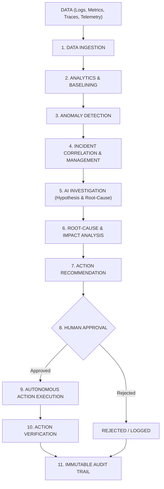

# Aegis Architecture Specification

## 1. Executive Summary

**Aegis** is an enterprise-grade, privacy-preserving AI Operations Intelligence platform designed to autonomously detect, investigate, and remediate complex operational incidents across distributed infrastructure while maintaining strict human-in-the-loop oversight and comprehensive auditability.

---

## 2. High-Level Operations Pipeline

The platform lifecycle follows a strictly governed, unidirectional data and decision flow:



### Stage Breakdown

1. **DATA**: Raw operational telemetry, including Prometheus/OpenTelemetry metrics, structured JSON logs, trace spans, and cloud infrastructure events.
2. **DATA INGESTION**: Streaming and batch ingestion workers that sanitize, validate, and normalize inbound signals while scrubbing sensitive credentials, tokens, and PII.
3. **ANALYTICS**: Time-series aggregation, baseline computing, seasonal pattern analysis, and sliding window statistical evaluations.
4. **ANOMALY DETECTION**: Statistical and machine learning models detecting metric deviations, throughput cliffs, error bursts, and latent memory leaks.
5. **INCIDENT MANAGEMENT**: Spatial-temporal correlation engine grouping related anomalies across downstream microservices into unified, actionable incidents to eliminate alert fatigue.
6. **AI INVESTIGATION**: Specialized operations intelligence agents traversing service dependency graphs, correlating log messages, examining recent deployments, and identifying root causes.
7. **ROOT-CAUSE & IMPACT ANALYSIS**: Detailed diagnosis quantifying blast radius, affected customer tenants, and financial/SLA impact.
8. **ACTION RECOMMENDATION**: Generation of verified remediation playbooks (e.g., rolling back a bad canary deployment, scaling a saturated Kubernetes worker pool, rotating a compromised certificate).
9. **HUMAN APPROVAL**: Interactive gate requiring explicit authorization from authorized SRE or SecOps personnel before any modifying infrastructure action is initiated.
10. **ACTION EXECUTION**: Idempotent execution of approved remediation tasks via secure, authenticated connectors.
11. **VERIFICATION**: Closed-loop post-remediation health probing to verify that operational metrics have returned to safe baselines.
12. **AUDIT TRAIL**: Cryptographically verifiable, immutable audit ledger capturing every anomaly, investigation step, engineer decision, and action outcome.

---

## 3. Modular Monolith Architecture

For Phase 1 & 2, Aegis is built as a **Modular Monolith**.

### Architectural Rationale

1. **Premature Complexity Avoidance**: Microservices introduce distributed transaction challenges, network latency, distributed tracing overhead, and complex local developer tooling. For an operational intelligence platform, the business logic boundaries (ingestion, anomaly detection, investigation) must stabilize before being physically decoupled into discrete network services.
2. **Single Deployment Unit, Strict Boundaries**: The codebase is architected with strict directory and package boundaries (`app/analytics`, `app/agents`, `app/models`, `app/services`, `app/security`). No module directly mutates private state of another module; interactions take place through defined interfaces and service abstractions.
3. **High Developer Velocity**: A single repository and unified runtime allow developers to spin up the entire platform locally with a single command, run full integration tests in seconds, and execute migrations deterministically.
4. **Clean Extraction Path**: Because module boundaries mirror domain boundaries, any high-throughput component (e.g., the high-frequency telemetry ingestion worker or the vector similarity search index) can be cleanly extracted into an independent microservice in the future without major refactoring.

---

## 4. Security & Isolation Boundaries

Aegis enforces a strict tiered security model:

```
[ Frontend (Next.js) ]
       ↓ (HTTP / JSON over TLS)
[ Backend API Gateway (FastAPI) ]
       ↓ (Internal Python Services)
[ Core Domain Logic / Agents ]
       ↓ (Connection Pooled Sessions)
[ PostgreSQL Relational Database ]
```

* **Frontend to Database Prohibition**: The frontend client NEVER communicates directly with PostgreSQL. All data queries, mutations, and status checks pass through authenticated FastAPI endpoints.
* **Telemetry Sanitization**: All loggers and ingestion processors strip sensitive fields (passwords, JWTs, API tokens, credit card patterns) before persistence or LLM context ingestion.
* **Least Privilege Agent Access**: The future AI investigation agent interacts exclusively through restricted read-only SQL queries or structured tool functions—it never possesses raw superuser database access.

---

## 5. Database & Domain Data Model Architecture

The data tier (implemented in Group 2) implements 18 core domain entities modeled in SQLAlchemy 2.0 and migrated via Alembic:

- **Organizational Core**: `Company`, `Customer`, `Order`, `OrderItem`
- **Telemetry & Events**: `OperationalMetric`, `SystemEvent`, `Deployment`
- **Customer Feedback**: `SupportTicket`, `CustomerComplaint`
- **Operational Intelligence**: `Anomaly`, `Incident`, `IncidentAnomaly`, `IncidentEvidence`
- **AI Diagnostics & Action**: `Investigation`, `InvestigationHypothesis`, `Recommendation`, `Action`
- **Compliance**: `AuditLog` (append-only, isolated from cascade deletes)

Refer to [docs/database.md](database.md) for full schema definitions, indexing strategies, and sensitive field specifications.

---

## 6. Incident Management & Correlation Subsystem (Group 5)

Implemented under `app/incidents`, this subsystem bridges deterministic statistical detection (Group 4) and the upcoming AI Investigator (Group 6):

* **Deterministic Deduplication**: 4-hour temporal window SHA-256 fingerprinting prevents alert duplication.
* **Strict State Machine**: `OPEN` $\to$ `INVESTIGATING` $\to$ `MITIGATED` $\to$ `RESOLVED` $\to$ `CLOSED` (terminal).
* **Multi-Source Timeline**: Unified chronological aggregation with deterministic relevance scoring ($0.10$ to $0.99$).
* **Blast Radius Estimation**: Algorithmic financial and operational revenue/order impact evaluation.

---

## 7. Privacy, Security & Data Governance Subsystem (Group 7)

Implemented under `app/security` and `app/agents`, this subsystem establishes an impermeable security boundary around enterprise operational data and the AI Investigator:

* **Data Sanitization & Redaction**: Centralized `DataSanitizer` scans all tool outputs, operational evidence, and application logs to mask credentials, tokens, API keys, passwords, credit cards, emails, and database URLs.
* **Deterministic Pseudonymization**: `Pseudonymizer` produces stable HMAC-SHA256 tokens for customer and user entities, preserving entity continuity across multiple incidents without exposing real identities to the AI.
* **Strict AI Tool Allowlisting**: The AI Investigator is restricted to 11 typed operational tools. Arbitrary SQL (`execute_sql`), shell execution (`execute_shell`), and raw file access are strictly forbidden and audited.
* **Context & Resource Guardrails**: Configurable `InvestigationLimits` restrict query time windows (max 24 hours), tool calls per run (max 20), and record batch sizes (max 50) to prevent denial of service.
* **Anti-Hallucination Evidence Validation**: The system validates every evidence citation generated by the AI against real database records prior to persistence.
* **Server-Side RBAC**: Role-based access control (`VIEWER`, `ANALYST`, `OPERATOR`, `ADMIN`) enforced directly in FastAPI dependencies.
* **Zero Chain-of-Thought Persistence**: In compliance with enterprise audit standards, hidden reasoning traces are never stored. Only verifiable facts, inferences, hypotheses, and recommendations are persisted.

* **Monotonic Severity**: Defensible rules with escalation guarantees; severity never automatically down-scales.
* **Multi-Source Timeline**: Reconstructs unified chronological events with automatic PII masking.
* **Evidence Management**: 8 first-class evidence types with deterministic relevance scoring $[0.10, 0.99]$.
* **Auditing & Governance**: Mandatory human acknowledgement, resolution summaries, and append-only audit trails.

Refer to [docs/incident-management.md](incident-management.md) for comprehensive subsystem documentation.

---

## 8. Aegis Operations Intelligence Dashboard (Group 8)

The Operations Intelligence Console transforms Aegis into a high-precision operational cockpit, serving SREs, Incident Commanders, and Engineering Leadership:

```
[ Next.js 15 Console (App Router) ]
   ├── Polling Engine (10s, 30s, 60s, paused)
   ├── Auth Context & Role Switcher (VIEWER, ANALYST, OPERATOR, ADMIN)
   ├── Global Command Palette (Cmd+K across incidents, investigations, systems, anomalies)
   └── Boundary Presentation Engine
         ├── OBSERVED FACT (Teal: Verified telemetry & immutable events)
         ├── AI ASSESSMENT (Purple: Probabilistic candidate hypotheses & correlations)
         └── RECOMMENDATION (Amber: Advisory mitigation playbooks)
               ↓ (Strictly consumes backend REST APIs via HTTP / JSON)
[ FastAPI Backend Gateway ]
   ├── GET /api/v1/overview
   ├── GET /api/v1/incidents & /incidents/{id}
   ├── GET /api/v1/investigations & /investigations/{id}
   ├── GET /api/v1/analytics/run & /metrics & /anomalies
   ├── GET /api/v1/systems & /systems/{name}
   ├── GET /api/v1/recommendations
   ├── GET /api/v1/audit
   ├── GET /api/v1/settings
   └── GET /api/v1/search
```

### Key Architectural Tenets
1. **Zero Mock/Fake Data**: Every metric, KPI, timeline event, evidence item, and investigation finding is loaded directly from backend PostgreSQL via FastAPI.
2. **Strict Read-Only Advisory Scope (Group 8 vs Group 9)**: Recommendations and mitigations in Group 8 are presented in strictly read-only advisory mode. Automated remediation and human approval workflows belong to Group 9 (Action & Human Approval Engine).
3. **Calibrated Probabilistic Language**: Root-cause assessments strictly adhere to scientific uncertainty calibration (*"The deployment is temporally correlated with the service degradation... Causality has not been independently proven"*).
4. **Server-Side RBAC Enforcement**: Role selection in the UI dynamically dispatches `X-User-Role` headers to backend endpoints, demonstrating server-side permission gating (e.g. VIEWER cannot acknowledge incidents or trigger investigations).


