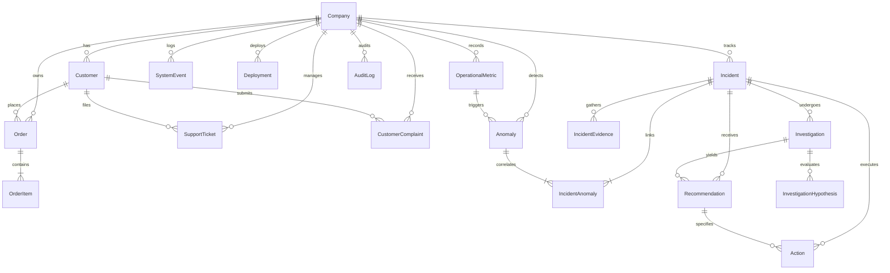

# Aegis Database Architecture & Schema Specification

## 1. Overview

The **Aegis** database architecture is designed for high-throughput operational telemetry, automated anomaly correlation, AI-assisted root-cause diagnostics, and compliance-grade auditability.

Built on **PostgreSQL 16** using modern **SQLAlchemy 2.0** declarative patterns (`Mapped[]`, `mapped_column()`, `relationship()`), the schema uses:
- **UUID Primary Keys**: Decentralized, globally unique entity identifiers (`Uuid` / `UUID`).
- **Timezone-Aware UTC Timestamps**: Strict UTC persistence across all lifecycle event timestamps.
- **Fixed-Point Decimal Money**: Precision `Numeric(12, 2)` preventing floating-point rounding errors for revenue and financial impact calculations.
- **Flexible Dimensionality**: Native PostgreSQL `JSONB` for multi-dimensional telemetry metadata and open-ended diagnostics.
- **Data Minimization & Privacy Protection**: Explicit demarcation of potentially sensitive PII fields.
- **Append-Only Compliance**: Non-cascading audit logging decoupled from business entity deletions.

---

## 2. Entity Model

The schema comprises 18 core domain entities organized across 6 functional sub-domains:



### Core Entities

| Table | Entity | Description | Key Attributes |
| :--- | :--- | :--- | :--- |
| `companies` | **Company** | Organization/Tenant using Aegis | `id`, `name`, `slug` (unique), `industry`, `status`, `created_at`, `updated_at` |
| `customers` | **Customer** | Synthetic end-user profiles | `id`, `company_id`, `external_reference`, `name`, `email` (*sensitive*), `phone` (*sensitive*), `region` |
| `orders` | **Order** | Transactional business orders | `id`, `company_id`, `customer_id`, `external_reference`, `status`, `currency`, `total_amount` (`Numeric(12,2)`), `ordered_at` |
| `order_items` | **OrderItem** | Individual line items in an order | `id`, `order_id`, `product_reference`, `quantity` (>0), `unit_price`, `total_price` |
| `operational_metrics` | **OperationalMetric** | Time-series telemetry measurements | `id`, `company_id`, `metric_name`, `timestamp`, `value`, `unit`, `source`, `dimension_data` (`JSONB`) |
| `system_events` | **SystemEvent** | Technical infrastructure signals | `id`, `company_id`, `event_type`, `severity`, `service`, `environment`, `message`, `timestamp`, `event_metadata` |
| `deployments` | **Deployment** | CI/CD software release events | `id`, `company_id`, `service`, `version`, `environment`, `status`, `deployed_at`, `deployed_by`, `deployment_metadata` |
| `support_tickets` | **SupportTicket** | Operational issues filed by users | `id`, `company_id`, `customer_id`, `category`, `priority`, `status`, `summary`, `created_at`, `resolved_at` |
| `customer_complaints`| **CustomerComplaint** | User sentiment and impact signals | `id`, `company_id`, `customer_id`, `category`, `severity`, `summary`, `created_at`, `resolved_at` |
| `anomalies` | **Anomaly** | Statistical observations from telemetry | `id`, `company_id`, `metric_id`, `metric_name`, `detected_at`, `observed_value`, `expected_value`, `deviation`, `detector_type`, `severity`, `confidence`, `explanation`, `status` |
| `incidents` | **Incident** | High-level operational outage/degradation | `id`, `company_id`, `title`, `summary`, `severity`, `status`, `detected_at`, `estimated_revenue_impact`, `estimated_orders_affected` |
| `incident_anomalies`| **IncidentAnomaly** | Many-to-Many association bridge | `incident_id`, `anomaly_id` |
| `incident_evidence` | **IncidentEvidence** | First-class diagnostic findings | `id`, `incident_id`, `source_type`, `source_id`, `title`, `summary`, `observed_at`, `relevance_score`, `evidence_metadata` |
| `investigations` | **Investigation** | AI diagnostic investigation session | `id`, `incident_id`, `status`, `started_at`, `completed_at`, `summary`, `root_cause`, `confidence`, `uncertainty` |
| `investigation_hypotheses` | **InvestigationHypothesis** | Candidate root-cause theories | `id`, `investigation_id`, `title`, `description`, `status`, `confidence`, `supporting_evidence_summary` |
| `recommendations` | **Recommendation** | Proposed mitigation strategies | `id`, `investigation_id`, `incident_id`, `title`, `description`, `priority`, `risk_level`, `expected_impact`, `status` |
| `actions` | **Action** | Executable corrective tasks | `id`, `recommendation_id`, `incident_id`, `action_type`, `approval_status`, `execution_status`, `requested_at`, `approved_by` |
| `audit_logs` | **AuditLog** | Immutable compliance audit record | `id`, `company_id` (nullable), `actor_type`, `actor_id`, `action`, `resource_type`, `resource_id`, `timestamp`, `request_id` |

---

## 3. Indexing Strategy

Indexes are tailored to high-frequency Aegis access patterns:

1. **Metric Time-Series Range Queries**:
   - `ix_metrics_company_name_timestamp` on `operational_metrics(company_id, metric_name, timestamp)`
   - `ix_metrics_company_timestamp` on `operational_metrics(company_id, timestamp)`
2. **Anomaly & Incident Triage**:
   - `ix_incidents_company_severity_status` on `incidents(company_id, severity, status)`
   - `ix_incidents_company_detected_at` on `incidents(company_id, detected_at)`
   - `ix_anomalies_company_severity` on `anomalies(company_id, severity)`
   - `ix_anomalies_company_status` on `anomalies(company_id, status)`
3. **Investigation Timeline Reconstruction**:
   - `ix_incident_evidence_incident_observed` on `incident_evidence(incident_id, observed_at)`
   - `ix_deployments_company_service_deployed_at` on `deployments(company_id, service, deployed_at)`
   - `ix_system_events_company_service_timestamp` on `system_events(company_id, service, timestamp)`
4. **Audit Log Forensics**:
   - `ix_audit_logs_company_timestamp` on `audit_logs(company_id, timestamp)`
   - `ix_audit_logs_resource` on `audit_logs(resource_type, resource_id)`

---

## 4. Privacy & Sensitive Field Designations

Aegis is architected with strict enterprise data privacy:
- **`customers.email`**: Tagged `@sensitive`. Contains email address for synthetic demo user contact. In production, must be hashed, tokenized, or pseudonymized before persistence.
- **`customers.phone`**: Tagged `@sensitive`. Telephone contact number.
- **Zero Raw Secrets in Logs or Database**: API keys, passwords, and authorization tokens are strictly forbidden from database fields, metadata JSON objects, and audit logs.
- **Immutable Audit Trail**: The `audit_logs` table stores action identifiers and actor references, never raw secrets. Deleting a `Company` sets `audit_logs.company_id` to `NULL` via `ON DELETE SET NULL`, preserving the compliance trail.

---

## 5. Seed Narrative: "The Checkout Service Connection Leak"

The seed dataset in [`backend/app/database/seed.py`](file:///d:/AEGIS/backend/app/database/seed.py) constructs a coherent incident story:

```
14:00 UTC  Deployment v4.8.2 of 'checkout-service' by CI bot
    ↓
14:05 UTC  DATABASE_ERROR: Connection pool exhaustion (100/100 active connections)
    ↓
14:06 UTC  api_error_rate surges from 0.12% to 18.5%
    ↓
14:07 UTC  checkout_failure_rate spikes from 0.02% to 42.8%
    ↓
14:08 UTC  Orders fail (ORD-9021, ORD-9022 with status FAILED)
    ↓
14:10 UTC  Customer complaints filed; URGENT support tickets submitted
    ↓
14:12 UTC  Anomalies detected by Z_SCORE and THRESHOLD detectors
    ↓
14:15 UTC  Incident 'Critical Checkout Service Outage' created (Severity: CRITICAL)
    ↓
14:16 UTC  Investigation started; evaluates deployment connection leak hypothesis
    ↓
14:18 UTC  Recommendation: Rollback 'checkout-service' to v4.8.1
    ↓
14:20 UTC  Action proposed: ROLLBACK_DEPLOYMENT (Pending human approval)
    ↓
14:20 UTC  Immutable audit trail recorded for each pipeline step
```

---

## 6. Migration Strategy

Database migrations are managed via **Alembic**:
- Initial baseline revision: [`backend/alembic/versions/001_initial_schema.py`](file:///d:/AEGIS/backend/alembic/versions/001_initial_schema.py)
- All 18 tables, check constraints, foreign keys, and indexes are defined for idempotent application (`alembic upgrade head`) and safe rollbacks (`alembic downgrade -1`).
